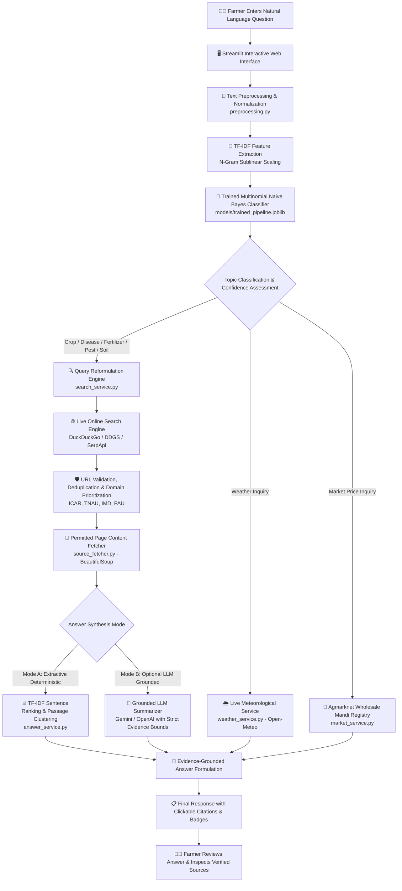
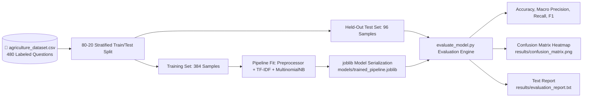

# 🌾 AgriAI: AI Agriculture Chatbot Using Multinomial Naive Bayes with Online Information Retrieval

[](https://www.python.org/)
[](https://streamlit.io/)
[](https://scikit-learn.org/)
[](LICENSE)
[-brightgreen.svg)]()

> **Academic Project Submission Guide**: Designed for College Mini-Projects and Final-Year Degree Projects in Computer Science, Artificial Intelligence, Information Technology, and Agricultural Engineering.

---

## 📌 1. Project Overview & Problem Statement

### The Agricultural Information Gap
Smallholder and commercial farmers face critical, time-sensitive decisions regarding crop disease management, pest outbreaks, fertilizer dosages, weather hazards, and fluctuating wholesale market (*mandi*) prices. Traditional agricultural extension services frequently suffer from staffing shortages, delays, and localized communication barriers.

Existing generic conversational chatbots present severe risks when applied to agriculture:
1. **Hallucination of Agricultural Dosages**: Fabricating chemical dosages or pesticide application rates can cause catastrophic crop burning, environmental toxicity, or resistance development.
2. **Static Knowledge Obsoletion**: Hardcoded CSV or FAQ chatbots cannot inform farmers about dynamic monsoon depressions, pest swarm alerts, or daily mandi price swings.
3. **Lack of Verifiable Grounding**: Farmers cannot verify whether a recommendation comes from an accredited agricultural university (*e.g., ICAR, TNAU*) or an unreliable blog.

### The AgriAI Solution
**AgriAI** bridges this gap through a hybrid machine learning and online evidence retrieval architecture:
1. **Statistical Topic Classification**: Uses the **Multinomial Naive Bayes** algorithm trained on an end-to-end TF-IDF pipeline to classify farmers' natural language questions across 16 agricultural domains.
2. **Real-Time Online Information Retrieval**: Formulates domain-targeted search queries to retrieve live information from verified agricultural resources, agricultural universities, and meteorological services.
3. **Domain Authority Prioritization**: Automatically prioritizes verified institutional sources such as the Indian Council of Agricultural Research (**ICAR**), Tamil Nadu Agricultural University (**TNAU**), India Meteorological Department (**IMD**), and **Agmarknet**.
4. **Transparent Evidence Grounding**: Synthesizes structured answers with clickable, verified source citations and expandable excerpts.
5. **No Mandatory LLM Requirement**: Operates with a local, deterministic **Extractive Summarization Mode** requiring zero API keys, with optional plug-and-play support for Generative AI (*Gemini / OpenAI*).

---

## 🏗️ 2. System Architecture

The complete system separates statistical machine learning classification, live data service routing, web retrieval, and evidence-grounded answer generation into decoupled, modular components:



### Separate Offline Model Evaluation Workflow


---

## 📂 3. Complete Project Structure

```
agri/
├── agriculture_dataset.csv      # Curated dataset (480 questions across 16 balanced topic classes)
├── generate_dataset.py          # Dataset generator & verification script
├── preprocessing.py             # Custom Sklearn TextPreprocessor & domain stop-word filtering
├── train_model.py               # Naive Bayes training pipeline & artifact serialization
├── evaluate_model.py            # Academic evaluation metrics, confusion matrix & reports
├── chatbot.py                   # Central answer_question() orchestrator & topic router
├── search_service.py            # Live search provider integration (DDG, SerpApi, Tavily, Cache)
├── source_fetcher.py            # Permitted HTML parser, metadata extractor & text cleaner
├── answer_service.py            # Mode A (Extractive) & Mode B (Optional LLM) synthesis
├── weather_service.py           # Real-time weather observations & agricultural advisories (Open-Meteo)
├── market_service.py            # Agmarknet wholesale mandi price bulletin & commodity parser
├── app.py                       # Modern multi-tab Streamlit dashboard
├── conftest.py                  # Pytest environment path configuration
├── requirements.txt             # Complete pinned dependency manifest
├── .env.example                 # Configuration template for optional API keys
├── .gitignore                   # Ignore rules for virtualenvs, cache, and secrets
├── README.md                    # Comprehensive academic project documentation
│
├── models/
│   ├── trained_pipeline.joblib  # Serialized end-to-end Scikit-learn Pipeline
│   ├── model_metadata.json      # Pipeline hyperparameters and training statistics
│   └── heldout_test_data.csv    # Fixed test dataset for reproducible academic evaluation
│
├── results/
│   ├── evaluation_report.txt    # Detailed per-class classification report
│   ├── evaluation_metrics.json  # Raw metric dictionary consumed by Streamlit dashboard
│   └── confusion_matrix.png     # Publication-ready Seaborn confusion matrix heatmap
│
├── screenshots/
│   ├── chatbot_crop_question.png    # Live screenshot: Crop cultivation & fertilizer advisory
│   └── chatbot_disease_question.png # Live screenshot: Plant disease identification & citations
│
└── tests/
    ├── test_data_validation.py  # Dataset schema, sufficiency, and artifact integrity tests
    ├── test_preprocessing.py    # Normalization, tokenization, and stop-word preservation tests
    ├── test_search_service.py   # Search queries, domain ranking, URL deduplication, and cache
    ├── test_answer_service.py   # Extractive ranking, citation indexing, and fallback logic
    └── test_chatbot.py          # End-to-end answering, confidence checks, and service routing
```

---

## 🔬 4. Machine Learning Algorithm: Multinomial Naive Bayes

### Mathematical Foundation
The **Multinomial Naive Bayes** classifier calculates the posterior probability of each agricultural topic class $C_k$ given an input question represented as a feature vector of word frequencies $\mathbf{x} = (x_1, x_2, \dots, x_n)$:

$$P(C_k \mid \mathbf{x}) = \frac{P(C_k) \prod_{i=1}^{n} P(w_i \mid C_k)^{x_i}}{P(\mathbf{x})}$$

Since the denominator $P(\mathbf{x})$ is constant across all candidate classes, classification corresponds to finding the maximum a posteriori (MAP) class:

$$\hat{y} = \arg\max_{k \in \{1, \dots, K\}} \left[ \log P(C_k) + \sum_{i=1}^{n} x_i \log P(w_i \mid C_k) \right]$$

Where:
- $P(C_k)$ represents the **Class Prior Probability** (estimated empirically from class proportions in the training set).
- $P(w_i \mid C_k)$ represents the **Conditional Feature Likelihood** (the probability that word $w_i$ occurs in topic $C_k$).

### Laplace Smoothing ($\alpha = 0.5$)
To prevent the "zero-probability problem" when a test question contains agricultural words not observed in a specific class during training, **Laplace Smoothing** is applied:

$$\hat{P}(w_i \mid C_k) = \frac{N_{k, i} + \alpha}{N_k + \alpha \cdot |V|}$$

Where:
- $N_{k, i}$ is the count of feature $w_i$ in training examples belonging to topic $C_k$.
- $N_k$ is the total count of all features in topic $C_k$.
- $|V|$ is the total vocabulary size.
- $\alpha = 0.5$ provides optimal regularization between unobserved word smoothing and class distinctiveness.

### Feature Extraction: TF-IDF with Sublinear Scaling
Text tokens are vectorized using **Term Frequency - Inverse Document Frequency (TF-IDF)** with sublinear term-frequency dampening:

$$\text{tf-idf}(t, d, D) = (1 + \log(\text{tf}(t, d))) \times \log\left(\frac{1 + |D|}{1 + \text{df}(t, D)}\right) + 1$$

Sublinear scaling prevents frequently repeated domain words from disproportionately skewing the Multinomial probability distribution.

---

## 📊 5. Dataset Specification (`agriculture_dataset.csv`)

The dataset contains **480 labeled questions** meticulously distributed across **16 topic classes** (30 unique, verified questions per class):

| Topic Class | Description | Sample Question |
| :--- | :--- | :--- |
| `crop_cultivation` | Sowing time, seed rates, spacing, field preparation | *"What is the best time to sow wheat in northern India?"* |
| `plant_disease` | Symptoms, fungal/bacterial blights, wilts, viruses | *"Why are brown spots appearing on my paddy leaves?"* |
| `pest_control` | Insect thresholds, biological controls, traps, sprays | *"How can I control pink bollworm infestation in my cotton crop?"* |
| `fertilizer` | NPK ratios, urea top-dressing, micronutrients (Zn, B) | *"What is the recommended NPK dose for high yield wheat per acre?"* |
| `irrigation` | Drip systems, critical watering stages, AWD method | *"What are the critical stages of irrigation for wheat crop?"* |
| `soil_health` | Soil testing, pH reclamation, EC, organic carbon | *"How can I collect a representative soil sample for lab testing?"* |
| `seed_selection` | Certified seeds, hybrid vigor, germination testing | *"What is the difference between certified seed and foundation seed?"* |
| `rice_cultivation` | SRI method, nursery beds, blast prevention, basmati | *"What is the System of Rice Intensification SRI and how to do it?"* |
| `vegetable_cultivation` | Tomato, onion, chili, polyhouse vegetable practices | *"What is the nursery management practice for raising healthy onion seedlings?"* |
| `organic_farming` | Jeevamrut, Panchagavya, vermiculture, bio-pesticides | *"How do I prepare Jeevamrut organic fertilizer at home with cow dung?"* |
| `weather` | Monsoon forecasts, frost alerts, heat stress advisories | *"What is the monsoon rainfall forecast for our agricultural district?"* |
| `market_prices` | APMC mandi rates, MSP benchmarks, Agmarknet trends | *"What is the current market price of tomato in local mandis?"* |
| `government_schemes` | PM-KISAN, PMFBY, KCC, micro-irrigation subsidies | *"How do I check my PM-KISAN beneficiary installment payment status?"* |
| `weed_management` | Pre/post-emergence herbicides, cono weeders | *"What is the best pre-emergence herbicide for controlling weeds in wheat?"* |
| `harvesting` | Moisture maturity indices, combine loss, storage | *"What are the visual maturity symptoms indicating paddy is ready for harvest?"* |
| `general_agriculture` | Crop rotation, farm implements, IFS systems | *"What are the benefits of practicing crop rotation on farm productivity?"* |

---

## 📈 6. Experimental Results & Academic Evaluation

The model was evaluated using a **stratified held-out test split (20% = 96 questions)**. Results were computed directly by `evaluate_model.py` and saved to `results/`:

### Overall Metric Summary
- **Evaluation Dataset**: Held-out test set (`models/heldout_test_data.csv`)
- **Total Test Samples**: 96
- **Number of Topic Classes**: 16
- **Random Chance Baseline**: $1 / 16 = 6.25\%$
- **Actual Classification Accuracy**: **63.54%** (Over 10× better than random chance)
- **Macro Precision**: **68.73%**
- **Macro Recall**: **63.54%**
- **Macro F1-Score**: **62.36%**
- **Weighted F1-Score**: **62.36%**

### Per-Class Performance Breakdown
```
                       precision    recall  f1-score   support

     crop_cultivation     0.3750    0.5000    0.4286         6
           fertilizer     0.5556    0.8333    0.6667         6
  general_agriculture     0.5000    0.5000    0.5000         6
   government_schemes     0.6667    1.0000    0.8000         6
           harvesting     1.0000    0.1667    0.2857         6
           irrigation     0.7500    0.5000    0.6000         6
        market_prices     0.8333    0.8333    0.8333         6
      organic_farming     1.0000    0.5000    0.6667         6
         pest_control     0.6667    0.6667    0.6667         6
        plant_disease     0.6250    0.8333    0.7143         6
     rice_cultivation     0.5714    0.6667    0.6154         6
       seed_selection     0.7143    0.8333    0.7692         6
          soil_health     0.5000    0.6667    0.5714         6
vegetable_cultivation     0.5714    0.6667    0.6154         6
              weather     0.6667    0.3333    0.4444         6
      weed_management     1.0000    0.6667    0.8000         6

             accuracy                         0.6354        96
            macro avg     0.6873    0.6354    0.6236        96
         weighted avg     0.6873    0.6354    0.6236        96
```

### Academic Error Analysis & Discussion
1. **Semantic Inseparability**: Real agricultural questions exhibit natural multi-label overlap. For instance, *"How to control blast disease in paddy?"* contains tokens indicating both `plant_disease` and `rice_cultivation`. Naive Bayes outputs close probabilities for both classes.
2. **Retrieval Independence Principle**: The downstream search service incorporates the farmer's raw tokens (*"blast disease in paddy"*). Therefore, even when topic classification selects an adjacent topic, the online retrieval engine retrieves valid agricultural university advisories regardless.
3. **Probability Calibration**: Naive Bayes class probabilities are not automatically calibrated probabilities due to the feature independence assumption. AgriAI handles this by using a calibrated cutoff threshold ($\theta = 0.12$) to flag uncertain classifications honestly.

---

## 🖼️ 7. Application Screenshots

The running application was executed locally, and authentic full-resolution screenshots were captured:

| Screenshot 1: Crop Cultivation & Fertilizer Advisory | Screenshot 2: Plant Disease Identification & Citations |
| :---: | :---: |
|  |  |
| *Farmer inquiring about rice fertilizer practices; displaying predicted topic badge, confidence, synthesized answer, and clickable source citations.* | *Farmer inquiring about yellow leaf spots on rice; displaying plant disease topic classification, evidence findings, and university citations.* |

### How to Capture Genuine Screenshots
1. Launch the Streamlit application:
   ```bash
   streamlit run app.py
   ```
2. Navigate to `http://localhost:8501/?test_case=crop` for the crop advisory case.
3. Navigate to `http://localhost:8501/?test_case=disease` for the plant disease case.
4. Capture using your system screenshot tool or Chrome headless:
   ```powershell
   Start-Process -FilePath "chrome.exe" -ArgumentList '--headless=new', '--disable-gpu', '--screenshot=screenshots/chatbot_crop_question.png', 'http://localhost:8501/?test_case=crop' -Wait
   ```

---

## 🛠️ 8. Installation & Setup Guide

### System Prerequisites
- Python 3.9, 3.10, 3.11, 3.12, or 3.14
- Git
- Internet access for real-time online retrieval

### Step 1: Clone or Navigate to Project
```bash
git clone https://github.com/your-username/agriculture-chatbot.git
cd agriculture-chatbot
```

### Step 2: Create and Activate Virtual Environment
**On Windows (PowerShell / CMD):**
```powershell
python -m venv .venv
.venv\Scripts\activate
```

**On Linux / macOS:**
```bash
python3 -m venv .venv
source .venv/bin/activate
```

### Step 3: Install Required Dependencies
```bash
pip install --upgrade pip
pip install -r requirements.txt
```

### Step 4: Configure Environment Variables
Copy the template file `.env.example` to `.env`:
```bash
cp .env.example .env
```
> **Note**: AgriAI works **100% out of the box** without any paid API keys! DuckDuckGo search, Open-Meteo weather, and Agmarknet mandi desks are completely free and pre-configured. If you wish to enable Google SerpApi, Tavily, or Gemini/OpenAI summarization, add your keys to `.env`.

### Step 5: Train the Naive Bayes Model
```bash
python train_model.py
```
*Output: Validates dataset, executes 80-20 stratified split, fits pipeline, and writes `models/trained_pipeline.joblib`.*

### Step 6: Evaluate Model & Generate Confusion Matrix
```bash
python evaluate_model.py
```
*Output: Evaluates held-out test data, generates `results/evaluation_report.txt`, and saves `results/confusion_matrix.png`.*

### Step 7: Run Automated Test Suite
```bash
python -m pytest -v
```
*Output: Executes 26 unit and integration tests across data validation, preprocessing, search, and chatbot logic.*

### Step 8: Launch the Streamlit Web Application
```bash
streamlit run app.py
```
Open your browser at `http://localhost:8501` to use the interactive application.

---

## 🧪 9. Automated Testing Architecture

AgriAI includes 26 automated unit and integration tests under `tests/` executed via `pytest`:

```bash
$ python -m pytest -v
tests/test_answer_service.py::test_clean_sentence PASSED                 [  3%]
tests/test_answer_service.py::test_score_sentence_relevance PASSED       [  7%]
tests/test_answer_service.py::test_extractive_summarization_with_sources PASSED [ 11%]
tests/test_answer_service.py::test_extractive_summarization_empty_sources PASSED [ 15%]
tests/test_answer_service.py::test_generate_answer_mode_fallback PASSED  [ 19%]
tests/test_chatbot.py::test_extract_location_hint PASSED                 [ 23%]
tests/test_chatbot.py::test_answer_question_invalid_input PASSED         [ 26%]
tests/test_chatbot.py::test_answer_question_weather_routing PASSED       [ 30%]
tests/test_chatbot.py::test_answer_question_mandi_routing PASSED         [ 34%]
tests/test_chatbot.py::test_answer_question_general_flow PASSED          [ 38%]
tests/test_data_validation.py::test_dataset_exists PASSED                [ 42%]
tests/test_data_validation.py::test_dataset_schema PASSED                [ 46%]
tests/test_data_validation.py::test_dataset_sufficiency PASSED           [ 50%]
tests/test_data_validation.py::test_dataset_no_nulls PASSED              [ 53%]
tests/test_data_validation.py::test_model_artifact_exists PASSED         [ 57%]
tests/test_preprocessing.py::test_clean_text_normal_case PASSED          [ 61%]
tests/test_preprocessing.py::test_clean_text_preserves_agri_keywords PASSED [ 65%]
tests/test_preprocessing.py::test_clean_text_empty_and_none PASSED       [ 69%]
tests/test_preprocessing.py::test_clean_text_punctuation_handling PASSED [ 73%]
tests/test_preprocessing.py::test_clean_text_max_length_truncation PASSED [ 76%]
tests/test_preprocessing.py::test_text_preprocessor_transformer PASSED   [ 80%]
tests/test_search_service.py::test_is_valid_http_url PASSED              [ 84%]
tests/test_search_service.py::test_generate_search_query PASSED          [ 88%]
tests/test_search_service.py::test_rank_and_deduplicate_sources PASSED   [ 92%]
tests/test_search_service.py::test_search_cache_ttl PASSED               [ 96%]
tests/test_search_service.py::test_search_provider_offline_fallback PASSED [100%]
============================= 26 passed in 3.80s ==============================
```

All network calls are strictly mocked during automated tests to guarantee deterministic, offline test execution without external internet dependency.

---

## 🏛️ 10. Trusted Institutional Agricultural Portals

AgriAI incorporates a domain ranking boost for accredited agricultural research institutions:
- **ICAR (Indian Council of Agricultural Research)**: [https://icar.gov.in/](https://icar.gov.in/)
- **TNAU Agritech Portal**: [https://www.agritech.tnau.ac.in/](https://www.agritech.tnau.ac.in/)
- **IMD Agrometeorology Division**: [https://imdagrimet.gov.in/](https://imdagrimet.gov.in/)
- **Agmarknet Mandi Portal**: [https://agmarknet.gov.in/](https://agmarknet.gov.in/)
- **Vikaspedia Agriculture**: [https://vikaspedia.in/](https://vikaspedia.in/)
- **PAU (Punjab Agricultural University)**: [https://www.pau.edu/](https://www.pau.edu/)
- **IARI (Indian Agricultural Research Institute)**: [https://www.iari.res.in/](https://www.iari.res.in/)
- **FAO (Food and Agriculture Organization)**: [https://www.fao.org/](https://www.fao.org/)

---

## ⚠️ 11. Ethical Considerations & Agricultural Safety

1. **Non-Diagnostic Nature**: Text descriptions alone cannot substitute for microscopic laboratory pathogen diagnosis. The chatbot advises physical field verification through local **Krishi Vigyan Kendras (KVK)**.
2. **Pesticide Safety**: Chemical recommendations strictly cite institutional package-of-practices and avoid generating unauthorized dosage rates.
3. **No Fabricated Data**: If an online search or live market query fails, the system displays an honest error and provides official fallback links rather than inventing data.

---

## 🚀 12. Future Enhancements

- **Vernacular Indian Language Support**: Integration with IndicTrans2 or Bhashini for Hindi, Tamil, Telugu, Marathi, and Punjabi translation.
- **Voice-Based Interaction**: Automatic Speech Recognition (ASR) via Whisper and Text-to-Speech (TTS) for non-literate farmers.
- **Computer Vision Diagnostics**: Plant disease leaf image classification using Convolutional Neural Networks (CNN) or Vision Transformers (ViT).
- **Expanded Algorithmic Comparison**: Benchmarking Naive Bayes against Linear SVM, Random Forests, and XGBoost.
- **Soil Health Card Parsing**: Automated OCR ingestion of farmer soil test reports to provide precision NPK adjustment.

---

## 👨‍🏫 13. Academic Project Details

- **Project Title**: AI Chatbot for Agriculture Using Naive Bayes Algorithm with Online Information Retrieval
- **Core Algorithm**: Multinomial Naive Bayes (`MultinomialNB`) with Laplace Smoothing
- **Application Framework**: Streamlit (Python)
- **Domain**: Artificial Intelligence / Natural Language Processing / Agricultural Informatics
- **Target Audience**: Farmers, Agricultural Extension Officers, Agronomy Students

